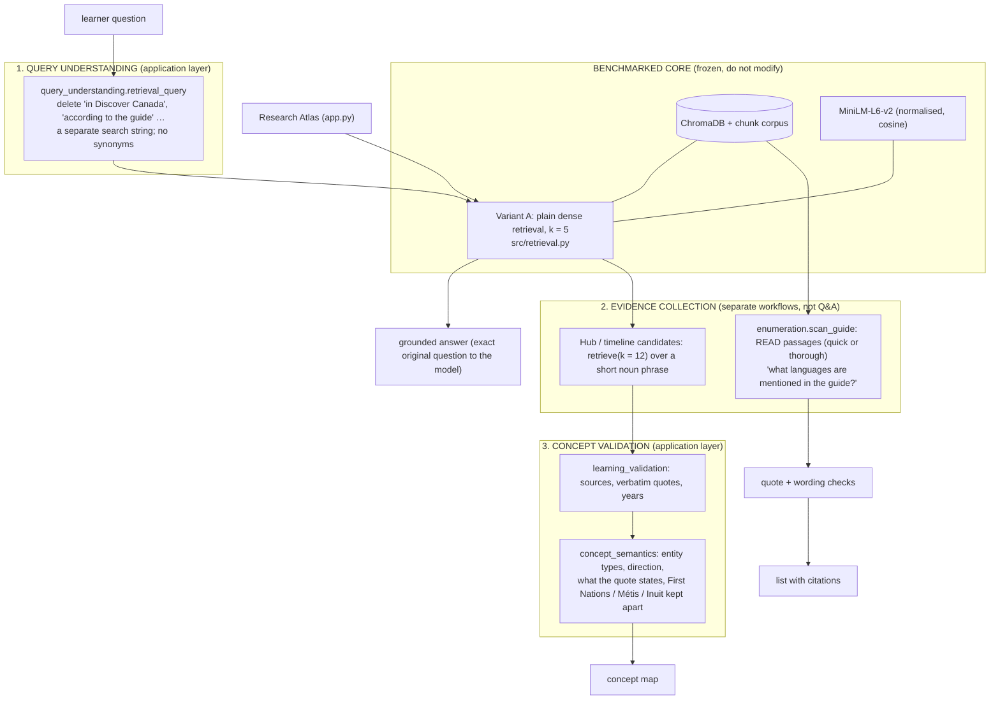

# The benchmarked core and the product layers around it

**Nothing in this document changes the frozen, benchmarked configuration.** The ChromaDB collection, the chunk corpus, the embedding model
(MiniLM-L6-v2, normalised, cosine) and the Variant A retrieval function (plain dense, k = 5; `src/retrieval.py`, mirrored from
`reference_rag.py`) are untouched. The held-out evaluation was not re-run and must not be re-run for these changes.

Three product layers sit **around** that core. They are application-layer transformations: each can be switched off or removed without
changing a single retrieval result, and none of them is part of what was benchmarked.

* The **Research Atlas** (`app.py`, `src/visualization.py`) still searches with the raw question through Variant A; a test enforces that it
  does not import the query cleanup.
* **Ordinary Q&A** (learner Learn page, voice) uses Variant A, k = 5, on the cleaned search string and gives the model the exact original question.
* **Enumeration** never calls the retriever: it reads passages from the corpus. It is a different action with a different button, cost and wording.

| Layer | Module(s) | What it may do | What it must not do |
|---|---|---|---|
| Benchmarked core | `src/retrieval.py`, `src/embeddings.py`, `src/corpus.py`, `reference_rag.py`, `chroma_db/` | answer retrieval exactly as benchmarked | change |
| Query understanding | `src/query_understanding.py` (via `tutor.search_text`) | delete document-reference boilerplate from the search string | add, replace or rewrite words; map synonyms or categories |
| Evidence collection | `src/enumeration.py`, `ui/enumeration_panel.py`; hub/timeline candidates in `learning_extractors.py` | read passages for "list everything" questions, with a stated scope and cost | widen the normal retriever; merge "dialect" or "word" into "language" |
| Concept validation | `src/concept_semantics.py`, `src/learning_validation.py` | reject or weaken relationships the text does not state | infer anything from outside knowledge |

---

## Change 1: retrieval-query cleanup

**Failure.** *"What first-nation languages are mentioned in Discover Canada?"* did not find the Michif passage: it ranked **78th** of 236, far
outside the top 5. The phrase "in Discover Canada" carries weight in a short query and pulls in generic passages about the guide and about
languages. ("What languages do Aboriginal peoples speak?" ranks the same passage 1st.)

**Fix.** `src/query_understanding.retrieval_query()` builds a *separate* search string by **deleting** document-reference boilerplate
("in Discover Canada", "in the guide", "according to the guide", "as described in the guide", "based on the guide", "does the guide mention",
"Discover Canada talks about"). It never adds or substitutes a word, so "First Nations", "Aboriginal", "Indigenous", "Métis" and "Inuit" are left
exactly as written (they are not interchangeable). If nothing would be left to search for ("What is in the guide?") the original is used.
The exact original question still goes to the model. `tutor.search_text()` applies it in `handle_turn` (voice, learner) and in the Learn page.
Disable with `QUERY_CLEANUP=0`; the result records the string that was embedded (`TurnResult.retrieval_query`).

**Measured (frozen retrieval, local embeddings, no LLM):**

| Question | Passage rank before → after |
|---|---|
| What languages are mentioned in Discover Canada, such as Michif? | 44 → 2 |
| What first-nation languages are mentioned in Discover Canada? (Michif) | 78 → 9 |
| What First Nation dialects Discover Canada talks about? (Michif) | 88 → 8 |
| What first-nation languages are mentioned in Discover Canada? (Inuktitut) | 16 → 9 |
| 8 other questions with boilerplate | unchanged, except "smallest province" 1 → 2 |

**Limit, stated plainly:** this does **not** make Michif appear in the top 5 for that question (rank 9 / 8). Without synonym mapping that is as
far as removing boilerplate goes. Questions that need *every* item are handled by change 3.

**Regression tests (`tests/test_query_understanding.py`, written before the change was enabled):** 14 boilerplate removals; 16 questions that
must come back unchanged (the guide as the topic, "What is in the guide?", empty input, group terms); group terms are never replaced or added
(8 terms); only deletion happens (output words ⊆ input words); idempotence; the search uses the cleaned string while generation receives the
exact original question; the switch turns it off; an unchanged question is searched exactly as asked; the frozen core and the Atlas do not
import the module; on the real frozen retrieval, cleaning never ranks the answering passage lower (±1 tolerance) for 9 questions.

## Change 2: concept-map semantic validation

**Failures** (the three existing diagrams, read against the guide's own text):

| Diagram | What was wrong |
|---|---|
| **First Nation Languages** | Inuktitut, Inuit, Michif and Métis were attached to *First Nations*. p. 11 says "About 65% of the Aboriginal people are First Nations, while 30% are Métis and 4% Inuit", and places Inuktitut with the Inuit and Michif with the Métis. The guide names no First Nations language here. Peoples were typed as "person" and languages as "concept"; the relationship "include" meant nothing; "Inuit — spoken by" read backwards. The summary mixed the peoples. |
| **Iroquoian** | "the name of Canada — name derived from" asserts a derivation the passage never states (it says Cartier heard *kanata*, and "by the 1550s, the name of Canada began appearing on maps"). kanata was a "concept", not a word; a language family was joined to a *word heard by* a person. |
| **Aboriginal languages** | "Inuktitut — spoken by" read backwards (a language is not the subject of "spoken by" the centre); the quote ("*Inuit* … in the Inuktitut language") does not say the Inuit speak it; "include" again. |

**Fix.** `src/concept_semantics.py`, called from `learning_validation.validate_hub_nodes` (hub prompt version `v4`, so timelines keep their cache):

1. **Entity types**: person, people, language, language_family, word, place, event, institution, concept. The model must classify the centre and every node.
2. **Typed predicates** with a signature and a direction (`speaks`: people→language, `word_in`: word→language/family, `prohibited_in`, `led_by`, …). The
   displayed phrase is chosen from predicate + direction, so "<centre> <phrase> <node>" always reads correctly. A backwards arrow is corrected only when
   the types make it unambiguous; types that do not fit are weakened, not drawn as stated.
3. **Support**: a typed relationship needs a cue in the evidence quote that actually states it ("speaks" needs speak/spoken/dialect; a derivation needs
   "derived/comes from/named after"). Without the cue it is **revised** to the neutral "is mentioned with" (only if the centre's topic word is near the
   quote), otherwise **rejected**. Free-text relationships ("invented by") are kept only if their words are in the quote.
4. **Group-scope guard**: First Nations, Métis and Inuit are separate; an item whose own sentence (or the sentence before it, for "They…") names another
   people is rejected, a sentence listing all three ties it to none, and "Aboriginal"/"Indigenous" are never treated as a group or as synonyms.
   A summary that brings in another people is dropped.

**Result on the real model and guide (after the fix):**

* *First Nation Languages* → **no nodes** and no summary (every item rejected with its reason). The learner app draws its existing "the guide does not
  state enough connected facts" message.
* *Iroquoian* → "Iroquoian **includes the word** kanata" (stated); Jacques Cartier, "captured guides" and "Canada (name)" only as "is mentioned with"; no derivation.
* *Aboriginal languages* → "**prohibited in** Residential schools" (stated, institution); Inuktitut and Michif only as "is mentioned with".

**Honest limits.** These are mechanical checks over the quote and its passage. They cannot prove that the model's one-sentence explanation or summary
adds nothing beyond the source (a summary is checked for years and for mixing peoples only). The "dialect ≈ language" equivalence is used in exactly one
place (is the centre's topic near the quote?) and never in retrieval or category mapping.

**Regression tests (`tests/test_concept_semantics.py`, 21):** the three diagrams built from the guide's p. 10, 11 and 14 text; Inuit/Métis rejected under First
Nations with reasons; the old mixed summary dropped; kanata kept with the right direction; derivation accepted only when stated; reversed arrow corrected;
people/language, word/family and institution/person not conflated; cue missing → weakened; item not in the passage → rejected; free-text support; the peoples'
scopes and no synonyms; a sentence listing all three peoples ties an item to none; "dialect" near the quote counts for the language topic; stated relationships
listed first; old cached hubs still load; the prompt carries the rules; an empty hub renders.

## Change 3: document-wide enumeration

**Failure.** "What languages are mentioned in the guide?" cannot be answered from 5 passages: the items sit in many places (English/French, Inuktitut, Chinese
languages, Punjabi, Michif, an Iroquoian word, Latin) and rank 9th to 78th for such a question.

**Investigation and fix.** `src/enumeration.py` is a **separate workflow** (own button, own cost, own wording; not reachable from Q&A; a test checks that
`tutor.py`, `retrieval.py`, `visualization.py` and `app.py` do not reference it, and that it never calls `retrieve`). It **reads** passages:

* **scope**: *quick* = only passages containing the learner's own word by literal stem match (no synonyms; 22 of 236 for "languages"); *thorough* = every passage;
* **extract**: a model reads batches of 8 passages and returns items with a verbatim quote;
* **validate**: real source, verbatim quote in that passage (≥ 3 words), the item is named, the quote holds the kind's word or the guide's own word, and with a
  people focus the passage must tie the item to that people (not another, and not none);
* **group**: items whose quote itself uses the requested word are listed first; items the guide words differently ("dialect", "word") are listed **separately** with
  the guide's word, never merged into the kind; "Chinese" and "Chinese languages" merge; every quote is kept;
* **report**: passages read, AI calls, anything dropped; results are cached; the panel (opt-in, `STUDY_ENUMERATION=1`) shows the plan and cost first.

**Measured on "languages"** (real guide and model; 3 quick runs and 2 thorough runs):

| Mode | Reads | AI calls | Items | Stable? |
|---|---|---|---|---|
| Quick | 22 passages | 3 (≈ 5–9 s) | English, French, Inuktitut, Chinese, Punjabi (as "languages"); Michif ("dialect") | identical in 3 of 3 runs |
| Thorough | 236 passages | 30 (≈ 15 s) | the above + Aboriginal languages, Non-official languages (varied in 1 of 2 runs); Iroquoian ("Iroquoian word"), Latin | 9 identical, 1 varied |

Quick found nothing that thorough missed; thorough added four items for 10× the calls. With a **First Nations** focus both modes return **nothing**, which is what
the guide supports (it names no First Nations language). **Limit:** it finds what the wording makes findable; an item named without the kind's word or the
guide's related word nearby can be missed, and an LLM extraction can vary between runs even at temperature 0.

**Regression tests (`tests/test_enumeration.py`, 16; `tests/test_enumeration_ui.py`, 2):** quick scope equals exactly the passages with the literal stem, in both
directions; "dialect" never added to a "language" scope; thorough reads everything and the plan states the cost; fabricated quotes, items not named, fabricated
sources and too-short quotes are dropped with the right reason; grouping by the guide's wording (Michif separate, with "dialect"); exactness comes from the quote, not
the model's label; merging; any explicit mention is enough; First Nations focus excludes Inuktitut and Michif and an Inuit focus keeps Inuktitut; cache hit makes no
calls; progress; empty request refused; temperature 0; separation from Q&A and the frozen core; the panel is hidden by default and shows its plan first.
