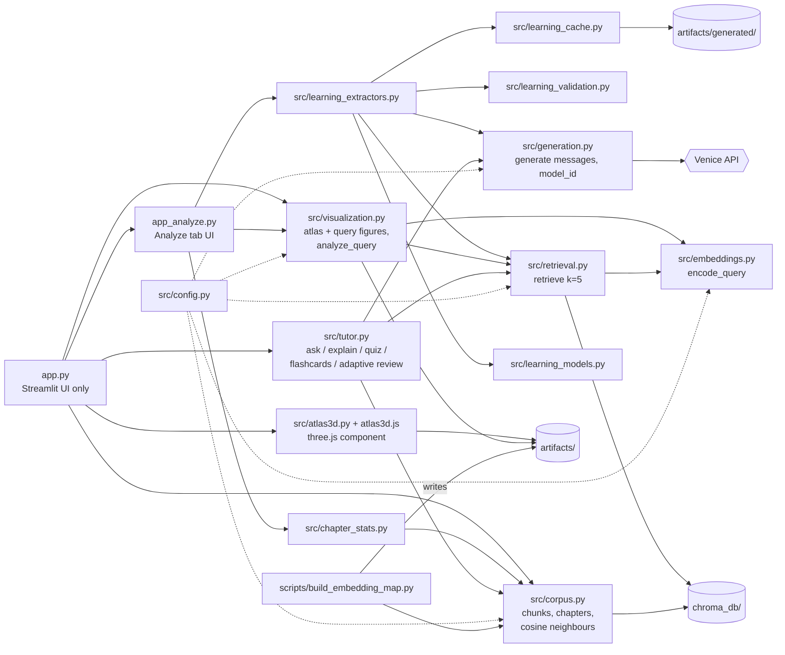
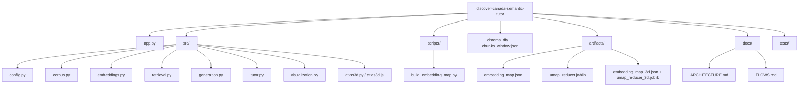
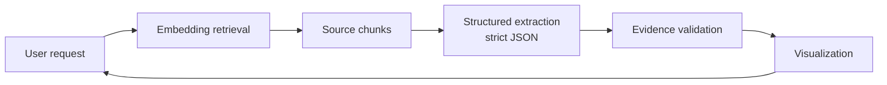

# Architecture

Discover Canada Atlas is a single-process **Streamlit** app over a **frozen** retrieval index.
There is no web server besides Streamlit, no database server, and no frontend build.
Diagrams below describe what is actually in the code.

## 1. Runtime components

Legend: 🟦 local static data · 🟩 local model computation · 🟥 external API call.

```mermaid
flowchart TD
    User([User]) --> UI[Streamlit UI<br/>app.py]

    UI --> Atlas[Atlas tab]
    UI --> Ask[Ask tab]
    UI --> Study[Study tab]
    UI --> Analyze[Analyze tab<br/>app_analyze.py]

    Atlas --> Corpus[corpus.py<br/>chunks + stored embeddings]
    Atlas --> Viz[visualization.py<br/>Plotly figures]
    Atlas --> Three[atlas3d.py + atlas3d.js<br/>three.js 3-D view]
    Ask --> Three
    Three --> UMAPArt
    Ask --> Viz
    Ask --> Tutor[tutor.py]
    Study --> Tutor
    Analyze --> ChapterStats[chapter_stats.py<br/>centroids, cosine, breadth]
    Analyze --> Extractors[learning_extractors.py<br/>retrieve - LLM JSON - validate]
    Analyze --> Viz
    ChapterStats --> Corpus
    Extractors --> Retrieval
    Extractors --> Corpus
    Extractors --> Gen
    Extractors --> Validate[learning_validation.py]
    Extractors --> Cache[(artifacts/generated/<br/>cached JSON)]

    Viz --> UMAPArt[(artifacts/<br/>embedding_map[_3d].json<br/>umap_reducer[_3d].joblib)]
    Viz --> Embed[embeddings.py<br/>MiniLM query encoder]
    Viz --> Retrieval[retrieval.py<br/>dense top-5, cosine]

    Tutor --> Retrieval
    Tutor --> Corpus
    Tutor --> Gen[generation.py]

    Retrieval --> Embed
    Retrieval --> Chroma[(chroma_db/<br/>discover-canada-window-minilm)]
    Corpus --> Chroma

    Gen -. only if VENICE_API_KEY is set .-> Venice{{Venice OpenAI-compatible API}}

    classDef data fill:#e8f0fe,stroke:#4a6fa5;
    classDef model fill:#e6f4ea,stroke:#3b7d4f;
    classDef ext fill:#fde8e8,stroke:#b3261e;
    class Chroma,UMAPArt,Cache data;
    class Embed model;
    class Venice ext;
```

- **Local static data**: `chroma_db/` (236 chunks + 384-d MiniLM vectors), `artifacts/` (UMAP map + fitted reducer).
- **Local model computation**: MiniLM encodes *queries only* (corpus vectors are read from Chroma); UMAP `transform` projects a query into the map.
- **External API**: Venice, called only from `generation.py`, only for Ask / Explain / Quiz / Flashcards / free-response grading.

## 2. Modules



| File | Owns |
|---|---|
| `app.py` | Receives UI actions, holds `st.session_state`, renders. No retrieval algorithms or prompts. |
| `src/config.py` | Frozen retrieval constants, artifact paths, UMAP params, env access (`VENICE_*`). |
| `src/corpus.py` | Loads all chunks + embeddings from Chroma; chapter derivation; cosine neighbours. |
| `src/embeddings.py` | The MiniLM encoder; `encode_query` (normalized). |
| `src/retrieval.py` | Frozen dense retrieval; Chroma safety guards (cosine space, embedding model). |
| `src/generation.py` | The **only** module that knows Venice. `generate(messages, model_id=None)`. |
| `src/tutor.py` | Prompts, citations, quiz/flashcards/explain, MMR diversity, adaptive review. |
| `src/visualization.py` | Loads the 2-D/3-D maps + reducers, projects queries, builds Plotly figures. |
| `app_analyze.py` | Analyze tab UI only (chapter map, concept/person hub, timeline). |
| `src/chapter_stats.py` | Chapter centroids, centroid cosine matrix, semantic breadth, nearest-neighbour rate, network rule. Original embeddings only; no LLM, no UMAP. |
| `src/learning_extractors.py` | Gathers evidence (retrieval or whole chapter), asks the LLM for strict JSON (one retry on bad JSON), validates, caches. |
| `src/learning_validation.py` | Drops items without source support: unknown source labels, quotes not found in cited text, unsupported years; merges duplicates. |
| `src/learning_models.py`, `src/learning_cache.py` | Dataclasses; `artifacts/generated/` JSON cache keyed by request + model + prompt version. |
| `src/atlas3d.py`, `src/atlas3d.js` | Thin `st.components.v2` wrapper + three.js scene for the 3-D atlas; returns clicked chunk ids. Loads three.js (pinned 0.160.0) from jsDelivr, so it needs internet. |
| `scripts/build_embedding_map.py` | One-off: fit UMAP on stored embeddings, write `artifacts/`. |

## 3. File tree

```
discover-canada-semantic-tutor/
├── app.py
├── app_analyze.py
├── README.md  AGENTS.md  CLAUDE.md  requirements.txt
├── .env            # user-owned secrets, never read by tooling
├── .env.example    # placeholders only
├── .streamlit/config.toml
├── chroma_db/                 # frozen index (collection discover-canada-window-minilm)
├── chunks_window.json         # canonical chunk copy (used by tests)
├── discover_canada.pdf
├── reference_rag.py           # research reference (tests compare against it)
├── environment_reference.yml
├── src/
│   ├── config.py  corpus.py  embeddings.py  retrieval.py
│   ├── generation.py  tutor.py  visualization.py  atlas3d.py  atlas3d.js
│   └── chapter_stats.py  learning_models.py  learning_extractors.py
│       learning_validation.py  learning_cache.py
├── scripts/build_embedding_map.py
├── artifacts/                 # embedding_map[_3d].json, umap_reducer[_3d].joblib
│   └── generated/             # cached LLM learning objects (git-ignored)
├── docs/                      # ARCHITECTURE.md, FLOWS.md
└── tests/test_smoke.py
```



## 4. Who answers what (Analyze tab)



| Layer | Answers |
|---|---|
| **Embeddings** | What content is semantically related? Which chapter is similar to which? Which chunks should we inspect? |
| **Source text** | What happened? When? What relationship is stated? What facts belong in the material? |
| **LLM** | How can the retrieved evidence be turned into a structured, readable learning artifact? |
| **Validation** | Does each extracted item have verbatim, in-source support (source labels, quote, years)? If not, omit it. |
| **Visualization** | How do we present that artifact clearly? |

Rules that follow from this: relationships and dates are **never** inferred from embedding closeness or from
UMAP/MDS positions; the LLM gets only retrieved source text; the chapter semantic map uses no LLM at all.
Hub/timeline candidate retrieval (`HUB_CANDIDATES_K`, `TIMELINE_CANDIDATES_K` = 12) is separate from, and
does not change, the frozen k=5 answer retrieval.

## 5. Questions a new developer asks

1. **What happens when a user types a query?** `app.py` → `visualization.analyze_query` encodes it once (`embeddings.encode_query`), retrieves top-5 with that vector (`retrieval.retrieve`), and projects the same vector with the saved UMAP reducer. Ask/Explain then call `tutor`. See [FLOWS.md](FLOWS.md) §A, §C.
2. **Which module calls which?** Section 2 diagram. Direction: `app` → `tutor`/`visualization`/`corpus` → `retrieval`/`generation` → `embeddings`/`corpus`/`config`.
3. **Where do embeddings come from?** Corpus vectors were computed in the research repo and live in Chroma; `corpus.load_corpus` reads them. Only *queries* are embedded at runtime (MiniLM, normalized).
4. **What is retrieved from Chroma?** `collection.query` → ids, documents, metadatas (page, section, block_type, …) and cosine distances; similarity = 1 − distance. No threshold, no reranking.
5. **What does UMAP do / not do?** It places chunks (and the query) on a 2-D map for humans to look at. It is **never** used for retrieval, neighbours, or diversity; those use the original 384-d cosine similarity. Points that look far apart on the map can be close in embedding space, and vice-versa.
6. **When is Venice called?** Only in `generation.generate`: Ask, Explain, quiz question writing + verification, free-response grading, flashcards.
7. **Which features work without Venice?** Atlas (filters, inspector, neighbours), query view (retrieval + map), MCQ *grading* of an already-generated question. Generation features show `VENICE_API_KEY is not configured.`
8. **What happens on a quiz request?** [FLOWS.md](FLOWS.md) §B: pick a source chunk in scope → choose distractor passages by cosine band (difficulty slider) → LLM writes question with wrong answers drawn from those passages → second LLM call verifies exactly one supported option → shuffle → grade locally → record in session state.
9. **How does adaptive review use neighbours?** After a miss, `tutor.review_candidates` takes the missed chunk's nearest chunks (cosine, one per other section, minus ones already answered correctly); the user can quiz or get an explanation over that neighbourhood.
10. **Where does each responsibility live?** Table in section 2.
