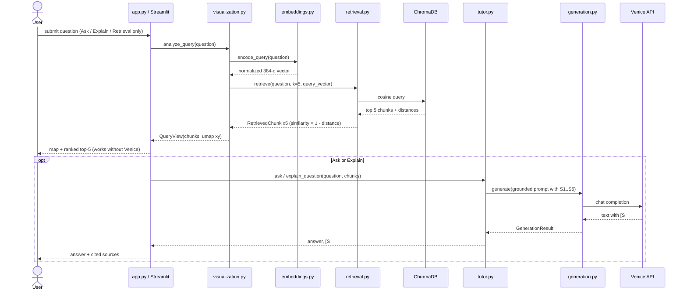
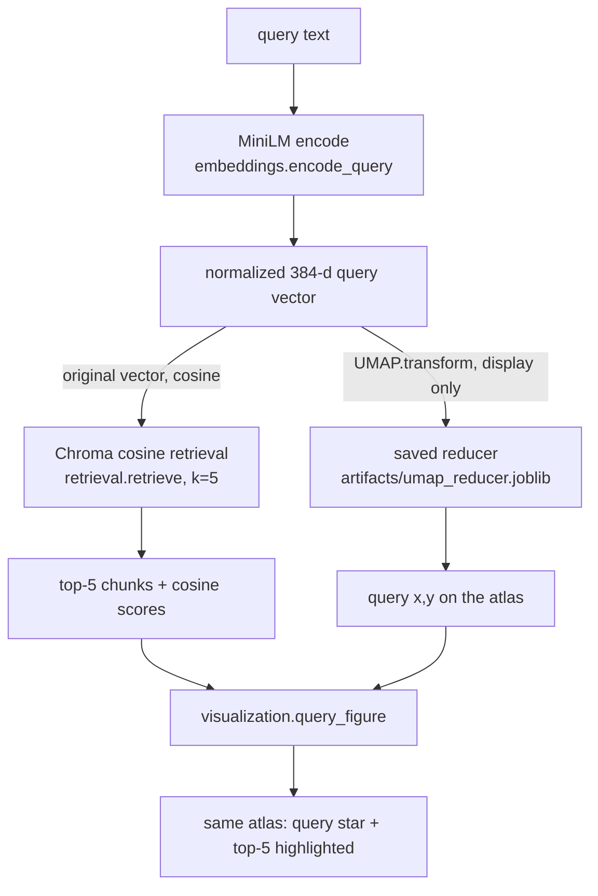
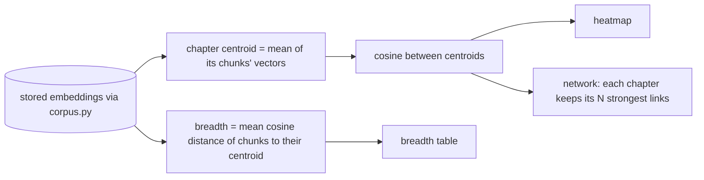
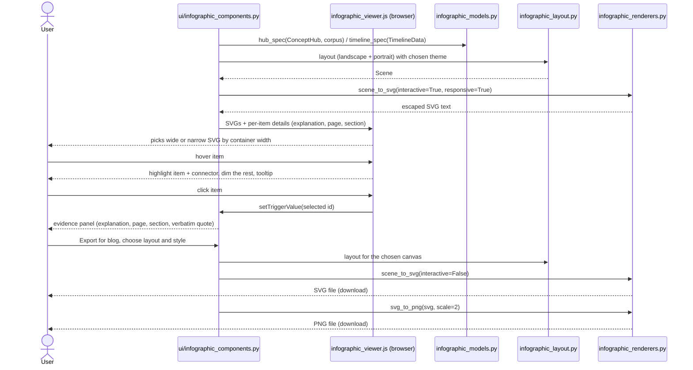
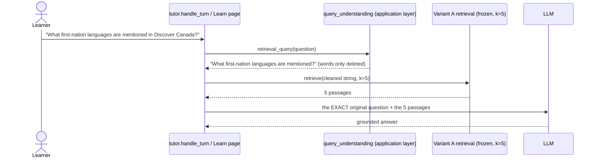
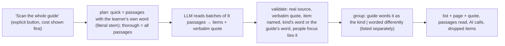
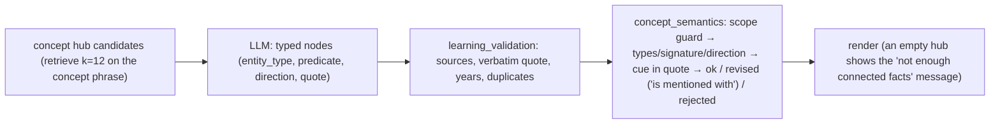

# Runtime flows

All flows reflect the implemented call paths. UMAP is display-only.

## A. Ask / Explain

`app.py` retrieves and draws the map **first**; generation runs afterwards so the retrieval view is
visible while the LLM works. The retrieved chunks from the atlas query are reused (no second retrieval).



## B. Quiz (multiple choice)

```mermaid
sequenceDiagram
    actor U as User
    participant UI as app.py
    participant T as tutor.py
    participant Co as corpus.py
    participant G as generation.py (Venice)

    U->>UI: New question (scope: guide / chapter / section / current query)
    UI->>T: generate_quiz(kind="mcq", scope, difficulty, exclude asked chunks)
    T->>T: pick_quiz_chunk (random usable chunk in scope)
    T->>Co: pick_distractor_passages(source, difficulty)
    Co-->>T: other-section passages ranked by cosine to source (original embeddings);<br/>difficulty slider picks the band: hard = nearest, easy = farthest
    T->>G: write question + 3 wrong answers, each drawn from a different passage
    G-->>T: JSON (question, correct answer, tagged distractors)
    T->>T: shuffle options in code
    T->>G: verify: which options does the source support?
    G-->>T: supported letters
    alt exactly one and it is the correct one
        T-->>UI: QuizQuestion (retry up to 3x otherwise)
    end
    UI-->>U: question + options
    U->>UI: choose answer
    UI->>T: grade_mcq (local, no LLM)
    T-->>UI: correct/incorrect + explanation + source page/section
    UI->>UI: append AnswerRecord to st.session_state.history
    opt answer was wrong
        UI->>T: review_candidates(missed chunk, history)
        T->>Co: neighbours of missed chunk, excluding chunks already answered correctly
        T-->>UI: nearby concepts
        U->>UI: Quiz nearby / Explain this neighbourhood
        UI->>T: generate_quiz(focus_chunk_id=neighbour) / explain_neighbourhood
    end
```

The difficulty slider (0 easy – 1 hard) is *similarity*: the wrong answers come from passages whose cosine
similarity to the source passage is high (hard) or low (easy). After answering, the UI shows each wrong
answer's source section and cosine, plus the measured cosine between the option texts. (Euclidean distance
on these unit vectors ranks identically to cosine.)

Free response differs only in that the LLM writes a question + reference answer (no distractors or
verification) and `grade_free` asks the LLM to judge the student's answer against the source.

## C. Atlas query flow

One query embedding, two distinct uses.



- The 3-D view (three.js) uses a second reducer fitted with `n_components=3`; the same single query vector is passed through it (`project_query_3d`). It is a display alternative to the 2-D Plotly map and follows the same rule.
- Retrieval uses the **original** embedding and cosine similarity.
- Visualization uses UMAP **only** to project the query into the 2-D atlas.
- UMAP coordinates are never a replacement for retrieval similarity: a retrieved chunk can appear far
  from the star, and the UI says so rather than hiding it.

## D. Atlas inspector

```mermaid
sequenceDiagram
    actor U as User
    participant UI as app.py
    participant V as visualization.py
    participant Co as corpus.py

    U->>UI: set filters (chapter / section / block type)
    UI->>V: atlas_figure(visible ids) - filtered-out points stay as faint grey
    U->>UI: click a point (Plotly selection -> chunk_id)
    UI->>Co: row(chunk_id), neighbours(chunk_id, 5)
    Co-->>UI: full text + metadata + cosine neighbours (original embeddings)
    UI-->>U: inspector; neighbours ringed on the map
```

In the 3-D view the same flow applies, except the click is captured in `atlas3d.js` (raycast on an instanced mesh) and returned to Python with `setTriggerValue('selected', chunk_id)`.

No generation is involved unless the user presses **Explain this chunk**.


## E. Chapter semantic map (no LLM)



Everything is computed on the original 384-d vectors (`chapter_stats.py`). Network node positions are a
classical-MDS layout of centroid distances; they are approximate and never used for any conclusion.

## F. Concept hub / person hub

```mermaid
sequenceDiagram
    actor U as User
    participant UI as app_analyze.py
    participant X as learning_extractors.py
    participant K as learning_cache.py
    participant R as retrieval.py
    participant G as generation.py (Venice)
    participant V as learning_validation.py
    participant Z as visualization.py

    U->>UI: concept or person, Build concept hub
    UI->>X: build_concept_hub(concept, kind, max_nodes)
    X->>K: cache lookup (concept, kind, model, prompt version, k)
    alt cache hit
        K-->>X: stored ConceptHub
    else miss
        X->>R: retrieve(concept, k=HUB_CANDIDATES_K=12)
        R-->>X: source chunks labelled S1..S12
        X->>G: strict-JSON request (nodes cite S-labels + exact quote); one retry on bad JSON
        G-->>X: JSON
        X->>V: validate_hub_nodes / validate_summary
        V-->>X: supported nodes (S-labels -> real chunk ids) + omitted reasons
        X->>K: save
    end
    X-->>UI: ConceptHub
    UI->>Z: hub_figure (radial) + optional evidence panel
```

A node survives only if its source labels were all supplied, its `evidence_quote` appears (case/punctuation
normalised) in a cited chunk, and any year in its explanation appears in the cited text. The person hub is the
same pipeline with a person-specific prompt (facts the guide states, no biography).

## G. Timeline

```mermaid
sequenceDiagram
    actor U as User
    participant UI as app_analyze.py
    participant X as learning_extractors.py
    participant C as corpus.py / retrieval.py
    participant G as generation.py (Venice)
    participant V as learning_validation.py
    participant Z as visualization.py

    U->>UI: chapter / section / topic, Build timeline
    UI->>X: build_timeline(...)
    alt chapter or section
        X->>C: every chunk in scope, document order, batches of TIMELINE_BATCH_CHUNKS
    else topic
        X->>C: retrieve(topic, k=12)
    end
    par each batch (parallel)
        X->>G: strict-JSON events (date_label, years, sources, exact quote)
        G-->>X: JSON
        X->>V: validate_events: sources, quote, dates present in text, duplicates merged
    end
    X->>X: merge across batches, sort chronologically; broad periods stay undated
    X-->>UI: TimelineData (cached)
    UI->>Z: timeline_simple (vertical) / timeline_layered (rows = guide section headings)
```

Dates are checked against the cited text (including ranges such as 1837–38). Events with only a broad
period ("late 1700s") are kept as such in a separate list instead of being given an invented year. Era rows in
the layered view are the guide's own section headings, never model-invented names.


## H. Infographic interaction and export



Nothing in this flow calls the LLM: the infographic is a pure function of the already validated JSON, so
changing theme, layout or canvas never changes a fact. The Venice key never leaves `generation.py`; the
component receives only SVG text and short details.

## I. Learner app (study_app.py)

Every action maps onto the same functions the research app uses:

| Learner action | Calls |
|---|---|
| Learn: explain / answer | `retrieval.retrieve` (frozen k=5) -> `tutor.explain_question` / `tutor.ask` |
| Learn: chapter | `tutor.explain_scope` |
| Practice | `tutor.generate_quiz` (difficulty Easy/Medium/Hard = the similarity band), `grade_mcq` / `grade_free`, `review_candidates` |
| Flashcards | `tutor.generate_flashcards` |
| Concept map | `learning_extractors.build_concept_hub` -> `render_hub_infographic` |
| Timeline | `learning_extractors.build_timeline` -> `render_timeline_infographic` |

Before each generation `ui/session_limits.charge()` reserves budget (default 40 actions per session,
`STUDY_MAX_ACTIONS`); cached hubs/timelines are refunded; topics are trimmed to 120 characters.


## J. Application layers around the frozen core (see APPLICATION_LAYERS.md)






