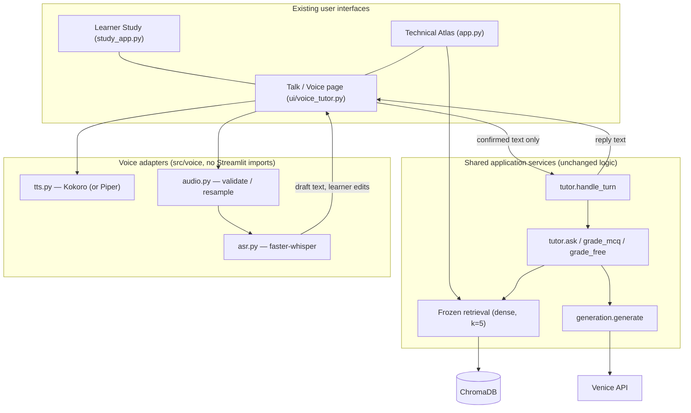
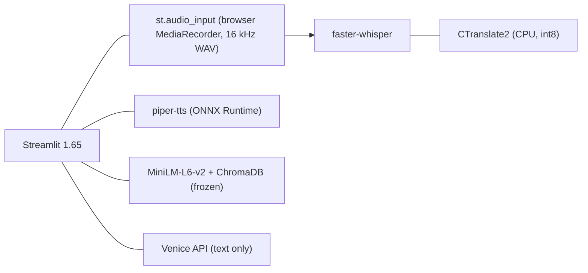
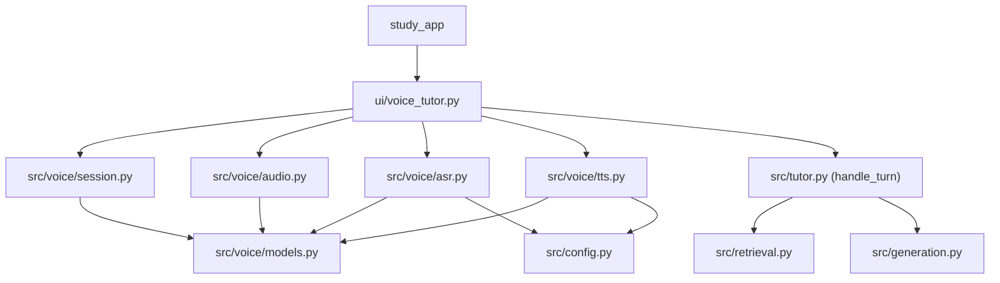
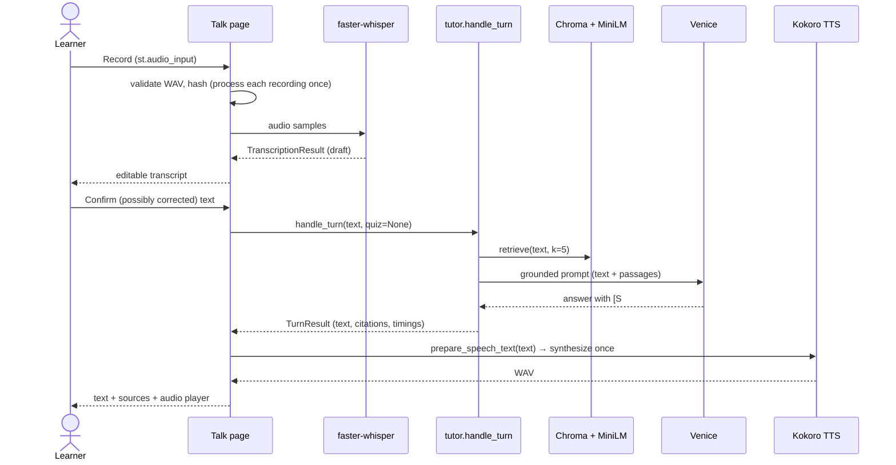
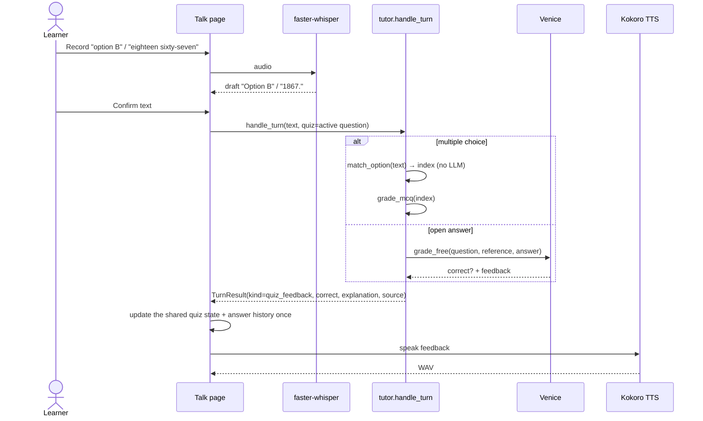
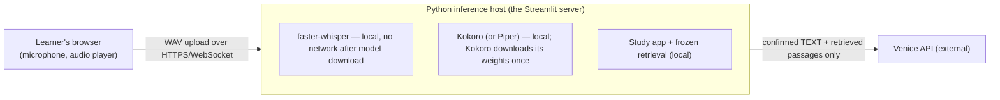
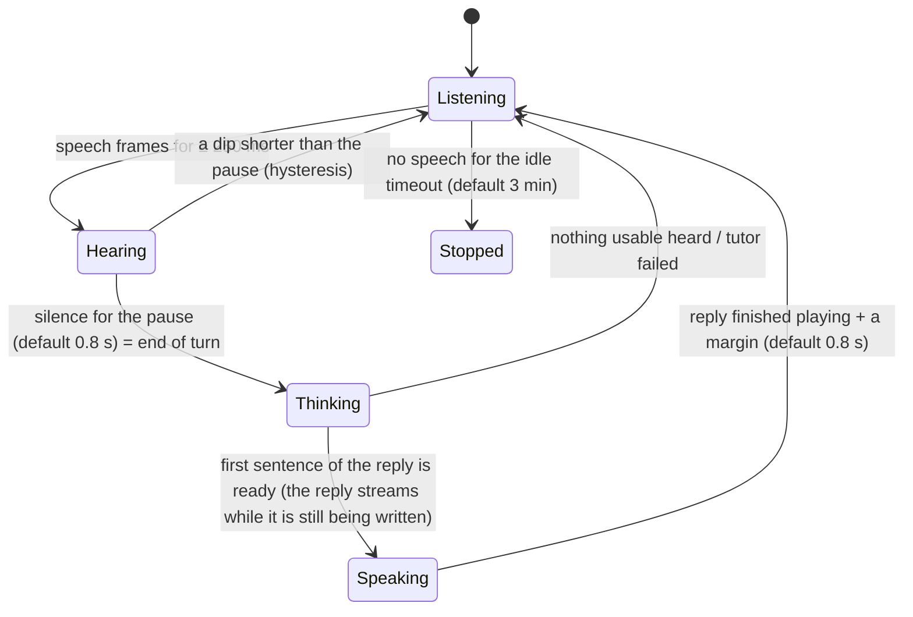
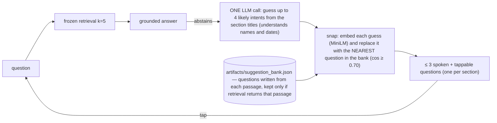

# Voice tutor — architecture (Milestone 1)

Milestone 1 adds **explicit-recording voice** to the learner app (`study_app.py`): record → transcribe locally → learner edits and
confirms the text → the *same* tutor code as the text UI answers or grades → the reply is shown with citations and spoken with a
local neural voice. The wake word is **not** implemented (Milestone 3); streaming/VAD turn-taking and talk-over (barge-in, for headphones) exist on the Atlas Live page only. Retrieval is
frozen and unchanged.

## What was inspected (the real architecture)

| Question | Finding |
|---|---|
| How is `https://ladan.io/discover_can_embedding_demo/` served? | A real Streamlit server in a Docker container on a 2 GB DigitalOcean droplet, started with `--server.baseUrlPath discover_can_embedding_demo`. Caddy reverse-proxies that path (WebSockets included); the Hugo site next to it is static. It is **not** a static front end. See `deploy/`. |
| How does the learner UI call the tutor? | `study_app.py` → `src/tutor.py` (`ask`, `explain_scope`, `generate_quiz`, `grade_mcq`, `grade_free`) → `src/retrieval.py` / `src/generation.py`. |
| Session state | `st.session_state` per browser session (`quiz`, `history`, `asked`, …). No database. |
| Quiz grading | MCQ: deterministic (`grade_mcq`). Open answer: one LLM call (`grade_free`). |
| Cost guard | `ui/session_limits.charge()` + `src/budget.py` daily ledger; every AI call goes through `generation.generate`. |

## A. High-level architecture



## B. Technology architecture



## C. Module dependencies



`src/voice/*` never imports Streamlit, `tutor` or `retrieval`; `tutor` knows nothing about speech.

## D. Sequences

### Spoken question → grounded answer → spoken reply


### Spoken quiz answer → grading → feedback

Not every turn uses retrieval or an LLM: an MCQ answer is graded deterministically; an unrecognised spoken option makes the tutor
ask again without grading or calling anything.

## E. Deployment and privacy



* **Local means local to the inference host**, not to each visitor's device. The visitor's audio is uploaded to the server that runs
  Streamlit; it is processed in memory and is never written to disk, logged, or sent to Venice.
* Only the learner-**confirmed text** (plus retrieved guide passages) reaches Venice — exactly what the typed UI already sends.
* Transcripts and raw audio are not logged. Recordings are limited to `VOICE_MAX_SECONDS` (default 30) and `VOICE_MAX_BYTES`
  (default 3 MB). The original ASR text is kept in the session only (for the edited-vs-heard diagnostics) and disappears with it.
* **Concurrency:** inference is CPU-bound; a process-wide semaphore (`VOICE_MAX_CONCURRENCY`, default 1) makes extra
  simultaneous visitors get a friendly "busy, try again" instead of piling up.
* **Hosting requirement:** the current 2 GB droplet runs the app only. Whisper `small` (int8) needs roughly 1 GB RAM plus ~1–2 CPU-seconds per
  second of speech; Kokoro ~0.5–1 GB RAM. A voice deployment should use ≥ 4 GB RAM / 2 vCPU, or a second small service. Therefore the
  Talk page is **off by default** (`STUDY_VOICE=1` enables it) and production behaviour is unchanged.
* **Licences — check before publishing a deployment:** `faster-whisper` (MIT), Whisper weights (MIT), Kokoro-82M (Apache-2.0); `piper-tts` (GPL-3.0 for the
  current `OHF-Voice/piper1-gpl` package) and **each Piper voice has its own licence** (many are CC-BY / CC0 / research-only). Read
  the model card of the voice you ship; the voice file is *not* bundled in this repository.

## Misheard names ("Papino" -> "Papineau")

Two layers, both before anything reaches the tutor, and the learner confirms the text either way:

1. **Whisper hints** (`ASR_INITIAL_PROMPT_DEFAULT` in `src/config.py`): Papineau, Macdonald, La Fontaine, Tecumseh, Iqaluit, Michif, Inuktitut, Champlain, Cartier, Laurier and others
   are given to the recogniser. Measured with a synthetic voice: without the hint "Louis-Joseph" came back as "Lee Joseph"; with Papineau in the list it was right.
2. **Sound-alike correction** (`src/voice/names.py`, rule-based, no model): a capitalised word of 5+ letters that the guide itself never uses and that has the **same consonant skeleton and first
   letter** as a known name is replaced (Papino/Papinow -> Papineau, Mackenzy -> Mackenzie, Champlin -> Champlain, Tecumsay -> Tecumseh). Similar spelling alone never counts, ties are left alone,
   possessives keep their "'s", and **every word the guide uses is protected**: a first, looser version changed 24 correct words in the guide's own text (Bell -> Billy, Paris -> Prairies), so
   `tests/test_voice_names.py` now runs the fixer over the whole guide and requires zero changes.

The draft box shows the fixed text plus "I fixed a name: “Papino” → “Papineau”"; the original recognised text is kept on the turn (`heard`), accepting the fix is not counted as a manual edit, and
Papineau stays a deliberate target even though he is not in the guide: the tutor then says it cannot find him (and offers nearby topics) instead of answering about "Papino".

## Milestone 2: hands-free turns (Live tab, technical Atlas only)

No Record or Stop. The browser streams the microphone; the server decides when you have finished, answers, speaks, and listens again. It lives in the
**technical Atlas** (`app.py`, tab "🎧 Live", shown with `STUDY_VOICE=1`); the deployed learner app (`study_app.py`) never imports it (a test enforces that).



```mermaid
sequenceDiagram
    participant B as Browser (WebRTC: mic in, voice out)
    participant P as LiveAudioPipe (worker thread)
    participant E as LiveEngine + Endpointer + Silero VAD
    participant U as Live page fragment (every 0.5 s)
    participant A as Whisper → name fix → tutor.handle_turn
    participant G as LLM stream (generation.generate_stream)
    participant S as SpeechStreamer + Kokoro (worker thread)
    B->>P: 20 ms mic frames, 48 kHz (echo cancellation + noise suppression on)
    P->>E: resample to 16 kHz mono, 32 ms frames
    E-->>E: speech probability per frame, hysteresis, pre-roll, hangover
    E-->>P: utterance (the moment the pause ends)
    P-->>B: acknowledgement ("One moment.", pre-synthesised) at once; the gate closes
    E-->>U: utterance (kept in memory only)
    U->>E: hold(): close the gate, forget anything half-heard
    U->>A: transcribe → fix names → handle_turn(on_text=…) (same code as the Talk page)
    A->>G: question + the frozen top-5 passages
    G-->>S: text pieces as they are written
    S-->>B: each finished sentence → Kokoro → voice track (the gate stays shut for the queued length)
    G-->>A: complete answer → citations resolved, abstention checked, as before
    A-->>U: TurnResult (+ the whole spoken reply as one WAV for replay)
    U->>E: release(0): audio already queued keeps the mic closed (+ margin)
```

**Speaking while the answer is written (Live page only).** The learner no longer waits for the whole answer and then the whole synthesis. `tutor.handle_turn(on_text=…)` hands the LLM's text on
as it arrives (`generation.generate_stream`: same key check, daily budget, retries and safe errors as `generate`; `<think>` blocks removed). `src/voice/speak.py: SpeechStreamer` cleans it exactly
like the one-shot path (`prepare_speech_text`: no citations, markup or JSON read aloud; spoken forms), cuts it into sentences and a worker thread synthesises them one at a time
(`tts.KokoroSynthesizer.pcm`), so sentence 1 plays while sentence 2 is still being written. Safeguards: the "I don't know" reply is recognised from its first words (`tutor.speak_verdict`) and
is never read out (the abstention turn's own text is spoken instead); a half-written citation is never spoken or split at; the spoken part is capped (Short 240 / Medium 500 characters or the
full reply) and ends with "There is more on the screen."; the answer, citations, grading and budget are the same code as without streaming, and the text on screen is unchanged. The voice goes
back to the browser over the same WebRTC connection (`streamlit-webrtc`: a `PcmAudioSource` output track plus a sink for the microphone), which also lets the browser's echo canceller know what is playing.

**Acknowledgement.** A few short phrases are synthesised once in the background (`speak.Acks`); the moment the engine decides you have finished (`LiveEngine(on_utterance=…)`, on the audio thread) one is
queued, so there is sound within a fraction of a second while Whisper and the LLM work. It does not make the answer sooner; it fills the wait. It can be switched off on the page and is off in Quiz mode.

* **Modules:** `src/voice/vad.py` (Silero ONNX, energy fallback), `src/voice/endpointing.py` (turn-taking logic, pure Python), `src/voice/live.py` (the engine: status, gate, queue),
  `src/voice/speak.py` (sentence streaming, speaker, acknowledgements), `ui/live_audio.py` (WebRTC frames → 16 kHz, worker thread), `ui/voice_live.py` (the page), shared `voice_tutor.send_turn` (the SAME answer/grade/charge code as the Talk page).
* **Turn-taking:** speech starts after ≥ 250 ms of speech frames (a cough never starts a turn), keeps 320 ms of lead-in, ends after the pause, keeps a 200 ms tail, cuts at 30 s;
  hysteresis (start ≥ 0.5, end < 0.35) stops a short dip inside a word from splitting a turn. Pause, sensitivity and idle timeout are sliders on the page.
* **Half-duplex by default, talk-over with headphones.** While the tutor is *thinking*, or playing a short phrase ("One moment."), the microphone is gated shut and the endpointer forgets everything (tested by
  streaming the tutor's reply back into the microphone: 0 turns). While it is *speaking a reply* the page has a switch, **"Let me talk over it (use headphones)"**, on by default: the microphone then stays open in a
  stricter mode (clear speech for ≥ 0.6 s, threshold ≥ 0.65; a cough, a breath, an "um" or a leak of the tutor's own voice does not count). When you do speak over it, the engine fires `on_interrupt`: the speaker's queue
  is cleared and its *epoch* advances (so a sentence that finishes synthesising a moment later is dropped, never spoken), the rest of the reply is aborted, and what you were saying, from its first word (it was in the pre-roll),
  becomes your next utterance. The screen still shows the whole answer. A **Stop talking** button does the same by hand. With loudspeakers, switch talk-over off (the tutor could hear itself); browser echo cancellation is on
  either way. Wake word ("Hey Moose") is still Milestone 3. Checked with the real Silero detector: real speech over the tutor interrupts after ≈ 0.6 s of speech; 3 s of breath-like noise and a 0.4 s "um" do not.
* **No "one moment" for noise.** Whisper runs first; "One moment." is spoken only once the words are recognised and are a real request, so breathing, "um", "cool" or "let me think about it" get no reply at all.
* **Everything is by voice (Live page).** There is no Ask/Quiz switch to click. `src/voice/intents.py` (plain rules, no model) turns a *short* utterance into a command: "ask me a multiple choice question" /
  "ask me an open question" / "quiz me" starts a question that is generated and read aloud with its options; "another question" / "skip" starts the next one (same kind); "stop the quiz" / "never mind" leaves it.
  While a question is open the words are its answer (a letter, "the second one", or the answer itself); once it is graded the page is back to normal questions automatically (earlier the page stayed in
  Quiz mode and ignored speech). A real question about the guide is never mistaken for a command (a test covers that).
* **Breathing, "um", noise.** A transcript that is only a hesitation (however stretched: "uuuuum"), a reaction ("cool", "nice"), thinking out loud ("let me think about it", "I'm thinking about my next question") or a word Whisper
  invents on near-silence ("you", "thank you") is dropped silently and gets no "one moment" (`intents.is_noise`; commands such as "next question" are checked first, and "yes"/"okay" count when a question or a "did you mean…?" is waiting). If the room is noisy, raise "Speech sensitivity".
* **"I'm still looking."** If nothing real has been spoken 5 s after you stopped (then every 6 s, at most 3 times) a short phrase is played (`speak.Patience`); it stops the moment the reply begins.
* **Spoken length.** Default is the whole answer ("Everything"; Medium ≈ 30 s, Short ≈ 15 s). Because the voice is streamed, reading everything does not delay the first word, but the microphone stays closed until it
  has finished, so the page has a **Stop talking** button (cuts the audio and reopens the microphone). Interrupting by voice is Milestone 3.
* **Automatic or reviewed:** by default a finished turn is sent automatically (names fixed, original kept). Untick "send automatically" to get the editable box back (Milestone 1's confirmation).
* **Spoken reply length** (Short ≈ 15 s / Medium ≈ 30 s / Full): the mic is closed while it talks, so long answers mean long waits. The full text and sources are always on screen.
* **Privacy:** audio is processed in memory on the inference host and a finished turn is dropped after transcription; nothing is written to disk or sent to Venice (only the transcribed text is, as before).
  WebRTC uses **no public STUN server by default** (`VOICE_LIVE_STUN=1` to enable Google's); on localhost the browser and server connect directly. The microphone is on only after you press START.

### Evaluation: Silero VAD vs the energy fallback (Kokoro speech + synthetic noise; not a real room)

| Condition | Silero | Energy |
|---|---|---|
| Cost per 32 ms frame | 0.10 ms | 0.002 ms |
| Clean | 2 turns, split at a 0.9 s pause | same |
| Fan noise (rms 0.005) | 2 turns | **merged into 1** |
| Noisy room (rms 0.02) | 2 turns, 0 false starts | merged, 1 false start |
| Loud noise (rms 0.05, louder than the speech) | 2 turns, 0 false starts | merged, 1 false start |

Silero is the default; the energy detector is a fallback for quiet rooms only. **Not measured:** real microphones, real rooms, accents, children, very quiet speakers, or a speaker feeding back into the mic.

### Evaluation: streamlit-webrtc

* Since the streaming change the page uses `WebRtcMode.SENDRECV` with `create_audio_sink_track` (microphone in; frames are queued and processed on our own thread, so voice detection cannot stall the audio going out) and `create_pcm_audio_source_track` (the tutor's voice out, 24 kHz mono); the page polls the engine from an `st.fragment(run_every=0.5)`. Earlier (Milestone 2) it used `SENDONLY` with a per-stream processor.
* The browser sends 48 kHz stereo 20 ms frames; PyAV resamples them. Tested with real `av.AudioFrame`s (48/44.1/16/8 kHz, mono/stereo).
* **Streamlit's test harness cannot run it** (it needs a live session), so the page tests use a stand-in and the streaming path is tested with real frames.
* **Deployment caveat:** on localhost it needs nothing else. On a remote server WebRTC usually needs a TURN server (and TLS) for visitors behind NAT; the server also processes every learner's live audio
  (CPU per concurrent user). That is why it is limited to the local Atlas. A browser-side VAD (e.g. Silero in WASM) that sends only finished utterances would avoid WebRTC; not built or measured.
* Installing it replaces `av` 18 with 17 (an aiortc requirement); faster-whisper only uses `av` to decode files, and all tests still pass.
* Importing `silero_vad` sets PyTorch to **1 thread for the whole process**, which made Kokoro and the search model ~5× slower (a spoken reply took 38 s for 49 s of audio). `src/voice/vad.py` restores the thread count (a test guards it).

### Measured end to end (simulated learner: Kokoro speech streamed as 48 kHz stereo frames; real Silero, Whisper, tutor and TTS)

| Step | Typical | Notes |
|---|---|---|
| Learner stops → turn detected | = the pause setting (0.8 s) | the price of not cutting you off |
| Speech to text | 1.1–2.5 s | Whisper `small`, int8, CPU |
| Tutor (search + answer) | 1–6 s; ~12 s when it also guesses suggestions | model latency varies |
| Text to speech | 2–8 s for a 10–27 s reply | the whole reply is made before it plays |
| **Learner stops → reply starts** | **≈ 6–20 s** | too slow for natural conversation |

The biggest controllable piece is that the whole reply is synthesized before playback starts. The next improvement is to speak sentence by sentence (start playing after the first sentence); the gate logic
already handles a speaking time, so this changes only how audio is produced and queued. Not built.

## When the guide has no match ("did you mean…")

Retrieval is frozen (dense, k = 5) and works on meaning, not on rare names or numbers, so a question such as *"What happened in 1982 in
Canada?"* ranks generic history passages first, while the passages that mention 1982 sit around rank 18–60. The grounded answerer then
correctly abstains instead of guessing. The tutor does **not** change retrieval; it helps the learner re-ask, and only ever offers
questions the guide is known to answer:


* **Why a bank:** the guesses can contain things only the LLM knows ("which king ruled during the American Revolution?"). Snapping each
  guess to a bank question means the learner only sees questions the guide answers, so "a suggestion" and "not in the guide" cannot be
  confused. Checking the **embeddings of the guesses directly** was tried and does not work: on 24 labelled questions the retrieval
  similarity did not separate answerable from unanswerable ones (an unanswerable question scored 0.80, an answerable one 0.32), and
  MiniLM matches "1982" or "Papineau" to unrelated passages for the same reason retrieval misses them.
* **How the bank is built:** `scripts/build_suggestion_bank.py`, once and offline (~200 small LLM calls, under 2 minutes): 2 questions per
  passage written from the passage's own text, then a round trip, keeping a question only if the frozen retrieval returns its own passage
  (11 of 378 were dropped). A test re-checks a sample of the shipped bank on every run.
* **Runtime cost:** one extra LLM call, only on abstentions (previously 5). Tapping a suggestion is a normal question (one call).
* **Floor 0.70:** chosen from examples: snaps at 0.54–0.65 were junk (e.g. "What event led to the Great Depression…"), those at 0.73+ were
  sensible. It is a judgement from a small sample, not a tuned guarantee; if nothing is close the tutor asks for a specific person, place
  or event instead.
* **No sources on a refusal:** an abstaining turn shows no citations, and duplicate source labels are shown once.

## Voice choice

ASR: Whisper `small` via faster-whisper (`ASR_MODEL`). TTS: **Kokoro-82M** (Apache-2.0, 24 kHz, 54 built-in voices; default voice
`af_heart`, change with `KOKORO_VOICE`), chosen for a more natural voice than Piper (the project owner's decision) and over Chatterbox Nano for speed and no
gated access (Chatterbox Nano: ~2–3× realtime on CPU and a reference clip are needed). Measured here: Kokoro ≈ 0.15× realtime (a
22 s answer in ~3.2 s); Piper ≈ 0.03×. `Synthesizer` is a protocol, so `TTS_ENGINE=piper` still works and any other engine can be added
without touching the tutor.

Speech-only text handling (never changes what is shown): `prepare_speech_text` removes citations/markup, then `spoken_forms` says
"Elizabeth II" as "Elizabeth the Second", "World War II" as "World War Two", "St."/"Dr." in full and "1837–38" as "1837 to 1838".
For Kokoro only, `KOKORO_PRONUNCIATIONS` fixes names its G2P misreads (Champlain, Cartier, Laurier, Métis, Iqaluit, Pierre, Papineau,
Hippolyte, Fontaine, Nunavut) with inline phoneme markup; these are best-effort, checked by printing Kokoro's phonemes. Acronyms
(RCMP, CPR, P.E.I., B.C.) are already read letter by letter correctly.

## Speech-engine evaluation (measured on one Apple-silicon Mac, 12 cores; your hardware and the droplet will differ)

Same ~21 s tutor paragraph (RCMP, P.E.I., Queen Elizabeth II, Champlain), voice `af_heart`. "RTF" = time to generate ÷ audio length (lower is
faster; 1.0 = real time). I cannot judge how any of these sound; that is a listening test.

| Engine | Where it runs | Download | RTF | First sentence | Notes |
|---|---|---|---|---|---|
| Piper (lessac-medium) | server CPU | 63 MB | ~0.03 | n/a | fastest; the project owner found it a bit robotic |
| Kokoro, PyTorch (`TTS_ENGINE=kokoro`, default) | server CPU | 327 MB + torch | 0.15–0.16 | n/a (whole answer) | pronunciation fixes via misaki markup |
| Kokoro, ONNX int8 (`TTS_ENGINE=kokoro-onnx`) | server CPU | 92 MB + 28 MB voices, no torch | 0.34–0.40 | n/a | **~2× slower than PyTorch here**; threads and CoreML made no difference; its own espeak front-end mispronounces names, so the engine feeds it misaki phonemes (same fixes) |
| Kokoro in the browser, WebGPU fp16 (`kokoro-js`) | visitor's browser | 163 MB (browser-cached) | **0.11** | **0.7 s** | needs WebGPU; load 7 s first time, 0.5 s cached |
| Kokoro in the browser, WebGPU fp32 | visitor's browser | 326 MB | 0.11 | 0.8 s | no faster than fp16 |
| Kokoro in the browser, WASM q8 | visitor's browser | 92 MB | **1.47** | 9.7 s | slower than real time: unusable without threads (page was not cross-origin isolated) |

What this means:
* **Server-side:** PyTorch Kokoro is the fastest Kokoro path on this Mac; ONNX int8 buys size (~120 MB vs ~330 MB, no torch), not speed. It was not
  measured on the droplet's x86 CPU, which may behave differently.
* **In the browser:** with WebGPU it is as fast as or faster than the server and moves the load to the visitor, which is the interesting option for the
  2 GB droplet. Without WebGPU it is too slow, so it would need a fallback (server engine, or text only), and the first visit downloads ~163 MB.
* **Pronunciation:** both `kokoro-onnx` and `kokoro-js` use an espeak front-end that mispronounces Tecumseh ("TEK-um-say"), Champlain, Métis. Verified
  workaround: make the phonemes on the server with misaki (+ `KOKORO_PRONUNCIATIONS`), and feed them to the model (`is_phonemes=True` in Python;
  `tts.tokenizer` + `generate_from_ids` in the browser, tested). The server then needs only the light misaki step, not a neural model.
* `scripts/browser_tts_lab/` is the throw-away page used for the browser numbers (`python -m http.server` in that folder); it is not part of the app.

## Architecture decision record

| Decision | Why |
|---|---|
| Streamlit stays the front end | Learner app, quiz state, cost guard and deployment already exist; `st.audio_input` gives an explicit record/stop control without a new JS app or backend. |
| Explicit recording (no streaming) in M1 | Predictable, testable, no continuous microphone, no VAD tuning. Corrections are possible because nothing is sent until the learner confirms. |
| faster-whisper | Local, CPU-capable (CTranslate2 int8), accurate English, small API; no audio leaves the host. |
| Kokoro (default), Piper (optional) | Local neural TTS on CPU, no API cost, no audio leaves the host; swappable behind `Synthesizer`. Kokoro sounds more natural; Piper is faster. |
| One shared tutor core (`handle_turn`) | Voice is only an adapter: no second retrieval/grading/citation path; correctness is decided by existing code, never by the speech layer. |
| Wake word / VAD deferred | They need streaming audio, echo handling and false-activation measurement — a separate milestone with its own evaluation. |
| Voice deps optional and the page gated | Keeps the production image small; a missing model produces a clear message, and the transcript box still works by typing. |

## Layout

```
src/voice/{models,audio,asr,tts,session}.py   adapters + small session logic (no Streamlit)
src/suggestions.py + artifacts/suggestion_bank.json   the 'did you mean' question bank (built by scripts/build_suggestion_bank.py)
src/tutor.py                                   + TurnResult, handle_turn, match_option (shared with text)
ui/voice_tutor.py                              the Talk page (learner app) / Voice tab (Atlas, styled=False)
scripts/voice_proper_nouns.py                  dev tool: Canadian proper-noun ASR smoke test
tests/test_voice_*.py                          mocks only; no models, no API key
```
