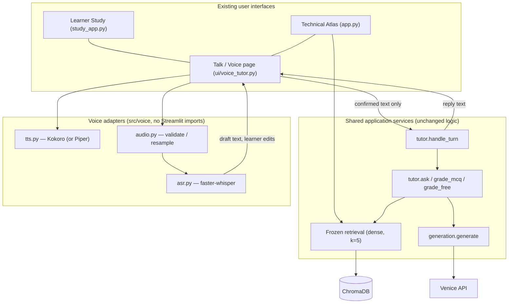
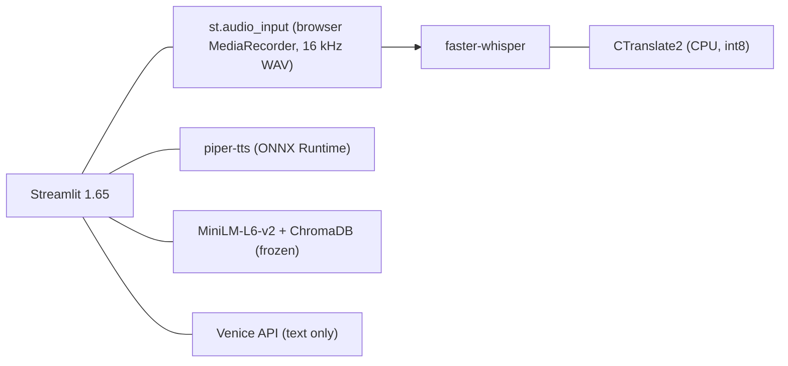
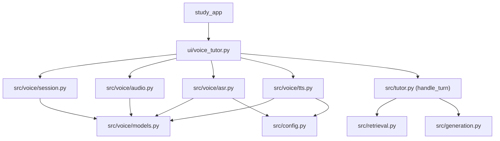
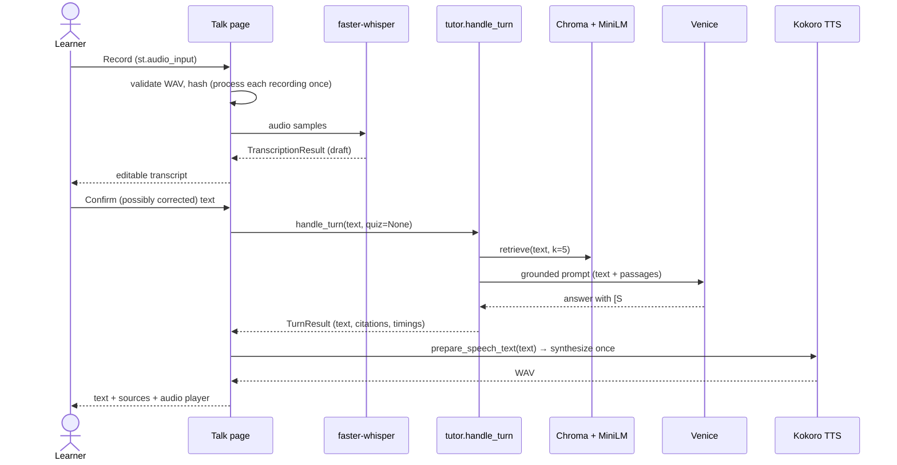
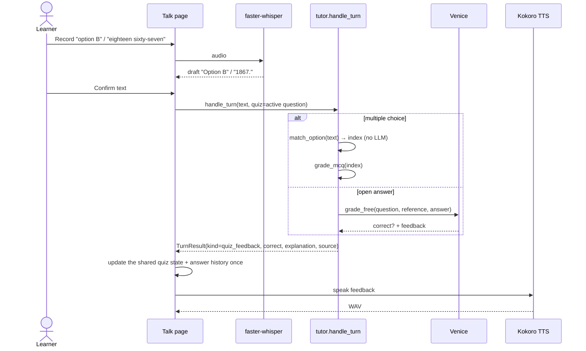
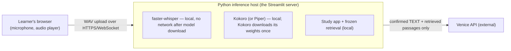
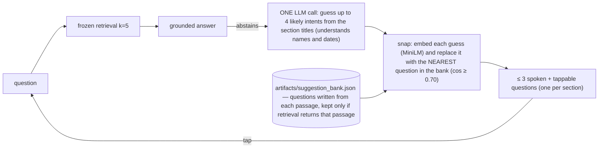

# Voice tutor — architecture (Milestone 1)

Milestone 1 adds **explicit-recording voice** to the learner app (`study_app.py`): record → transcribe locally → learner edits and
confirms the text → the *same* tutor code as the text UI answers or grades → the reply is shown with citations and spoken with a
local neural voice. Wake word, streaming/VAD turn-taking and barge-in are **not** implemented (Milestones 2–3). Retrieval is
frozen and unchanged.

## What was inspected (the real architecture)

| Question | Finding |
|---|---|
| How is `https://ladan.io/discover_can_embedding_demo/` served? | A real Streamlit server in a Docker container on a 2 GB DigitalOcean droplet, started with `--server.baseUrlPath discover_can_embedding_demo`. Caddy reverse-proxies that path (WebSockets included); the Hugo site next to it is static. It is **not** a static front end. See `deploy/`. |
| How does the learner UI call the tutor? | `study_app.py` → `src/tutor.py` (`ask`, `explain_scope`, `generate_quiz`, `grade_mcq`, `grade_free`) → `src/retrieval.py` / `src/generation.py`. |
| Session state | `st.session_state` per browser session (`quiz`, `history`, `asked`, …). No database. |
| Quiz grading | MCQ: deterministic (`grade_mcq`). Open answer: one LLM call (`grade_free`). |
| Cost guard | `ui/session_limits.charge()` + `src/budget.py` daily ledger; every AI call goes through `generation.generate`. |

## A. High-level architecture



## B. Technology architecture



## C. Module dependencies



`src/voice/*` never imports Streamlit, `tutor` or `retrieval`; `tutor` knows nothing about speech.

## D. Sequences

### Spoken question → grounded answer → spoken reply


### Spoken quiz answer → grading → feedback

Not every turn uses retrieval or an LLM: an MCQ answer is graded deterministically; an unrecognised spoken option makes the tutor
ask again without grading or calling anything.

## E. Deployment and privacy



* **Local means local to the inference host**, not to each visitor's device. The visitor's audio is uploaded to the server that runs
  Streamlit; it is processed in memory and is never written to disk, logged, or sent to Venice.
* Only the learner-**confirmed text** (plus retrieved guide passages) reaches Venice — exactly what the typed UI already sends.
* Transcripts and raw audio are not logged. Recordings are limited to `VOICE_MAX_SECONDS` (default 30) and `VOICE_MAX_BYTES`
  (default 3 MB). The original ASR text is kept in the session only (for the edited-vs-heard diagnostics) and disappears with it.
* **Concurrency:** inference is CPU-bound; a process-wide semaphore (`VOICE_MAX_CONCURRENCY`, default 1) makes extra
  simultaneous visitors get a friendly "busy, try again" instead of piling up.
* **Hosting requirement:** the current 2 GB droplet runs the app only. Whisper `small` (int8) needs roughly 1 GB RAM plus ~1–2 CPU-seconds per
  second of speech; Kokoro ~0.5–1 GB RAM. A voice deployment should use ≥ 4 GB RAM / 2 vCPU, or a second small service. Therefore the
  Talk page is **off by default** (`STUDY_VOICE=1` enables it) and production behaviour is unchanged.
* **Licences — check before publishing a deployment:** `faster-whisper` (MIT), Whisper weights (MIT), Kokoro-82M (Apache-2.0); `piper-tts` (GPL-3.0 for the
  current `OHF-Voice/piper1-gpl` package) and **each Piper voice has its own licence** (many are CC-BY / CC0 / research-only). Read
  the model card of the voice you ship; the voice file is *not* bundled in this repository.

## When the guide has no match ("did you mean…")

Retrieval is frozen (dense, k = 5) and works on meaning, not on rare names or numbers, so a question such as *"What happened in 1982 in
Canada?"* ranks generic history passages first, while the passages that mention 1982 sit around rank 18–60. The grounded answerer then
correctly abstains instead of guessing. The tutor does **not** change retrieval; it helps the learner re-ask, and only ever offers
questions the guide is known to answer:


* **Why a bank:** the guesses can contain things only the LLM knows ("which king ruled during the American Revolution?"). Snapping each
  guess to a bank question means the learner only sees questions the guide answers, so "a suggestion" and "not in the guide" cannot be
  confused. Checking the **embeddings of the guesses directly** was tried and does not work: on 24 labelled questions the retrieval
  similarity did not separate answerable from unanswerable ones (an unanswerable question scored 0.80, an answerable one 0.32), and
  MiniLM matches "1982" or "Papineau" to unrelated passages for the same reason retrieval misses them.
* **How the bank is built:** `scripts/build_suggestion_bank.py`, once and offline (~200 small LLM calls, under 2 minutes): 2 questions per
  passage written from the passage's own text, then a round trip, keeping a question only if the frozen retrieval returns its own passage
  (11 of 378 were dropped). A test re-checks a sample of the shipped bank on every run.
* **Runtime cost:** one extra LLM call, only on abstentions (previously 5). Tapping a suggestion is a normal question (one call).
* **Floor 0.70:** chosen from examples: snaps at 0.54–0.65 were junk (e.g. "What event led to the Great Depression…"), those at 0.73+ were
  sensible. It is a judgement from a small sample, not a tuned guarantee; if nothing is close the tutor asks for a specific person, place
  or event instead.
* **No sources on a refusal:** an abstaining turn shows no citations, and duplicate source labels are shown once.

## Voice choice

ASR: Whisper `small` via faster-whisper (`ASR_MODEL`). TTS: **Kokoro-82M** (Apache-2.0, 24 kHz, 54 built-in voices; default voice
`af_heart`, change with `KOKORO_VOICE`), chosen for a more natural voice than Piper (the project owner's decision) and over Chatterbox Nano for speed and no
gated access (Chatterbox Nano: ~2–3× realtime on CPU and a reference clip are needed). Measured here: Kokoro ≈ 0.15× realtime (a
22 s answer in ~3.2 s); Piper ≈ 0.03×. `Synthesizer` is a protocol, so `TTS_ENGINE=piper` still works and any other engine can be added
without touching the tutor.

Speech-only text handling (never changes what is shown): `prepare_speech_text` removes citations/markup, then `spoken_forms` says
"Elizabeth II" as "Elizabeth the Second", "World War II" as "World War Two", "St."/"Dr." in full and "1837–38" as "1837 to 1838".
For Kokoro only, `KOKORO_PRONUNCIATIONS` fixes names its G2P misreads (Champlain, Cartier, Laurier, Métis, Iqaluit, Pierre, Papineau,
Hippolyte, Fontaine, Nunavut) with inline phoneme markup; these are best-effort, checked by printing Kokoro's phonemes. Acronyms
(RCMP, CPR, P.E.I., B.C.) are already read letter by letter correctly.

## Speech-engine evaluation (measured on one Apple-silicon Mac, 12 cores; your hardware and the droplet will differ)

Same ~21 s tutor paragraph (RCMP, P.E.I., Queen Elizabeth II, Champlain), voice `af_heart`. "RTF" = time to generate ÷ audio length (lower is
faster; 1.0 = real time). I cannot judge how any of these sound; that is a listening test.

| Engine | Where it runs | Download | RTF | First sentence | Notes |
|---|---|---|---|---|---|
| Piper (lessac-medium) | server CPU | 63 MB | ~0.03 | n/a | fastest; the project owner found it a bit robotic |
| Kokoro, PyTorch (`TTS_ENGINE=kokoro`, default) | server CPU | 327 MB + torch | 0.15–0.16 | n/a (whole answer) | pronunciation fixes via misaki markup |
| Kokoro, ONNX int8 (`TTS_ENGINE=kokoro-onnx`) | server CPU | 92 MB + 28 MB voices, no torch | 0.34–0.40 | n/a | **~2× slower than PyTorch here**; threads and CoreML made no difference; its own espeak front-end mispronounces names, so the engine feeds it misaki phonemes (same fixes) |
| Kokoro in the browser, WebGPU fp16 (`kokoro-js`) | visitor's browser | 163 MB (browser-cached) | **0.11** | **0.7 s** | needs WebGPU; load 7 s first time, 0.5 s cached |
| Kokoro in the browser, WebGPU fp32 | visitor's browser | 326 MB | 0.11 | 0.8 s | no faster than fp16 |
| Kokoro in the browser, WASM q8 | visitor's browser | 92 MB | **1.47** | 9.7 s | slower than real time: unusable without threads (page was not cross-origin isolated) |

What this means:
* **Server-side:** PyTorch Kokoro is the fastest Kokoro path on this Mac; ONNX int8 buys size (~120 MB vs ~330 MB, no torch), not speed. It was not
  measured on the droplet's x86 CPU, which may behave differently.
* **In the browser:** with WebGPU it is as fast as or faster than the server and moves the load to the visitor, which is the interesting option for the
  2 GB droplet. Without WebGPU it is too slow, so it would need a fallback (server engine, or text only), and the first visit downloads ~163 MB.
* **Pronunciation:** both `kokoro-onnx` and `kokoro-js` use an espeak front-end that mispronounces Tecumseh ("TEK-um-say"), Champlain, Métis. Verified
  workaround: make the phonemes on the server with misaki (+ `KOKORO_PRONUNCIATIONS`), and feed them to the model (`is_phonemes=True` in Python;
  `tts.tokenizer` + `generate_from_ids` in the browser, tested). The server then needs only the light misaki step, not a neural model.
* `scripts/browser_tts_lab/` is the throw-away page used for the browser numbers (`python -m http.server` in that folder); it is not part of the app.

## Architecture decision record

| Decision | Why |
|---|---|
| Streamlit stays the front end | Learner app, quiz state, cost guard and deployment already exist; `st.audio_input` gives an explicit record/stop control without a new JS app or backend. |
| Explicit recording (no streaming) in M1 | Predictable, testable, no continuous microphone, no VAD tuning. Corrections are possible because nothing is sent until the learner confirms. |
| faster-whisper | Local, CPU-capable (CTranslate2 int8), accurate English, small API; no audio leaves the host. |
| Kokoro (default), Piper (optional) | Local neural TTS on CPU, no API cost, no audio leaves the host; swappable behind `Synthesizer`. Kokoro sounds more natural; Piper is faster. |
| One shared tutor core (`handle_turn`) | Voice is only an adapter: no second retrieval/grading/citation path; correctness is decided by existing code, never by the speech layer. |
| Wake word / VAD deferred | They need streaming audio, echo handling and false-activation measurement — a separate milestone with its own evaluation. |
| Voice deps optional and the page gated | Keeps the production image small; a missing model produces a clear message, and the transcript box still works by typing. |

## Layout

```
src/voice/{models,audio,asr,tts,session}.py   adapters + small session logic (no Streamlit)
src/suggestions.py + artifacts/suggestion_bank.json   the 'did you mean' question bank (built by scripts/build_suggestion_bank.py)
src/tutor.py                                   + TurnResult, handle_turn, match_option (shared with text)
ui/voice_tutor.py                              the Talk page (learner app) / Voice tab (Atlas, styled=False)
scripts/voice_proper_nouns.py                  dev tool: Canadian proper-noun ASR smoke test
tests/test_voice_*.py                          mocks only; no models, no API key
```
